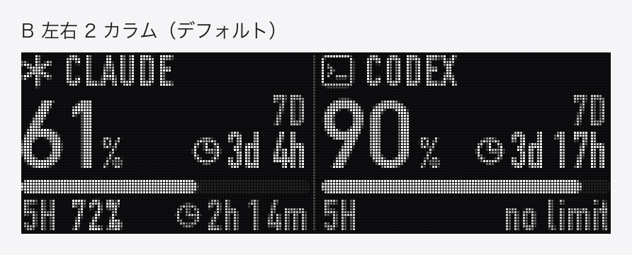
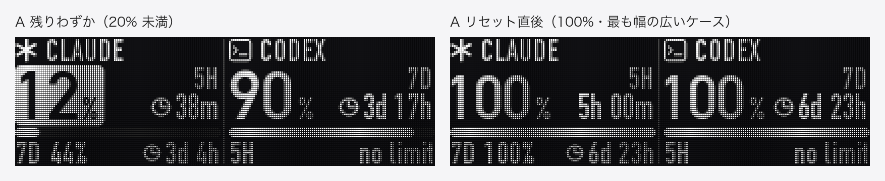
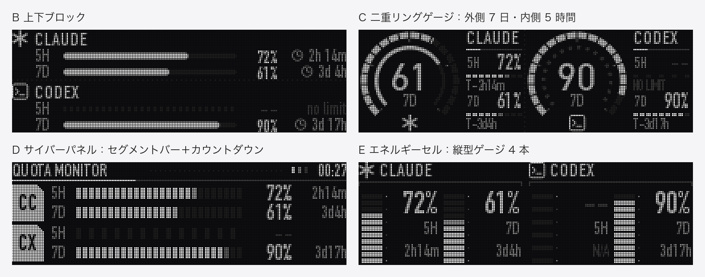

# rog-omni-oled

[English](README.md) | [简体中文](README.zh-CN.md) | **日本語**

ROG Omni レシーバー経由で接続した ROG キーボードの OLED 画面を macOS から操作します。テキストや画像を表示したり、**Claude Code / Codex の残り使用枠をリアルタイムで表示するダッシュボード**にしたりできます。



## 機能

- **ネイティブ画質**：208×64 ピクセル、16 階調グレースケール。アンチエイリアスの効いた文字と、ディザリングした画像を表示できます。
- **使用枠ダッシュボード**：左が Claude、右が Codex。大きな数字は、5 時間枠と 7 日枠のうち残りが少ないほうの残量で、隣にリセットまでのカウントダウンを表示します。残りが 20% を切ると数字が反転表示になります。
- **常駐動作**：launchd でログイン時に自動起動します。画面が変わったときだけ送信し、更新のたびにキーボードのフラッシュへ書き込むことはありません。離席中やキーボードのスリープ中は、取得も送信も止めます。
- **コマンドラインツール**：テキスト 1 行や画像 1 枚をいつでも送れます。ROG の内蔵アニメーションに戻すこともできます。
- **メニューバー**：Mac のメニューバーに使用枠とキーボードのバッテリー残量をリアルタイムで表示します。ドロップダウンメニューには、リセット時刻、CPU／メモリ、ネットワーク速度、日付と時刻も表示します。

## 動作環境

| | |
|---|---|
| OS | macOS（Apple Silicon で動作確認）。ダッシュボードは macOS 標準のフォントを使います |
| 実行環境 | Python 3.9 以降。Node 18 以降（Claude の使用枠を取得する場合のみ） |
| 接続方式 | ROG Omni レシーバー（USB `0B05:1ACE`）経由の 2.4GHz ワイヤレス接続のみ。有線は未対応で、**Bluetooth モードでは使えません** |
| 確認済みハードウェア | Omni レシーバーでペアリングした ROG キーボード 1 台（レシーバーが返すキーボードの PID は `0x1C23`）。プロトコルの原作者は ROG Azoth で確認しています。OLED 画面付きのほかの ROG キーボードでも動く可能性はありますが、未確認です |

> **Bluetooth モードでは使えません。** キーボードを Bluetooth で Mac に接続すると、macOS が提供するのは標準のキーボード・マウス・メディアキーのインターフェースだけで、画面データの送信に使うベンダー定義インターフェース（usage page `0xFF00`）がありません。そのため OLED 画面を操作できません（実機で確認済み）。Omni レシーバーを挿し、キーボードを 2.4GHz モードに切り替えてください。

## インストール

```bash
git clone https://github.com/ldk-tokyo/rog-omni-oled.git
cd rog-omni-oled
python3 -m venv .venv
.venv/bin/pip install -r requirements.txt
```

## コマンドライン

```bash
.venv/bin/python rog_oled.py status                       # 接続状態とバッテリー残量
.venv/bin/python rog_oled.py text "こんにちは"              # テキスト 1 行（フォントサイズは自動）
.venv/bin/python rog_oled.py text "GG" --size 40           # フォントサイズを指定
.venv/bin/python rog_oled.py text "Hi" --preview p.png --dry-run   # プレビュー画像だけ作り、送信しない
.venv/bin/python rog_oled.py image logo.png                # 画像（自動で縮小し、16 階調にディザリング）
.venv/bin/python rog_oled.py animation 0                   # 内蔵アニメーションに戻す（0–5）
```

キーボードがスリープ中の場合は、キーを押すよう案内が出て、復帰したところで送信します。コマンドラインから送った内容はキーボードに保存され、抜き差ししても残ります。

## 使用枠ダッシュボード

```bash
./install.sh      # ログイン時に起動するサービスとしてインストールし、すぐに起動。最初にインストールする部分を選びます（ログ：~/Library/Logs/rog-oled.log）
./uninstall.sh    # 停止して削除
.venv/bin/python quota_daemon.py --once   # 1 回だけ更新（トラブルシューティング用）
```

`install.sh` は足りない依存関係（Python の仮想環境と `usage/` 内の Node パッケージ）を自動でインストールします。Claude にまだログインしていない場合は、ログイン用のコマンドを表示します。

### インストールする部分を選ぶ

`./install.sh` を実行すると、インストールする部分を選ぶよう求められます。そのまま Enter を押すと両方をインストールします。オプションで直接指定することもできます。

| オプション | インストールする内容 | ROG キーボード |
|---|---|---|
| `--keyboard` | キーボード部分のみ：OLED 画面の使用枠ダッシュボード | 必要 |
| `--mac` | Mac 部分のみ：[メニューバー](#メニューバー)。デーモンは `--no-keyboard` で動き、使用枠データの取得だけを担当し、レシーバーには接続しません | 不要 |
| `--all` | 両方 | 必要 |

切り替えるときは `install.sh` をもう一度実行してください。選ばなかった部分は削除されます。ターミナルなし（スクリプトからの呼び出しなど）でオプションも指定しなかった場合は、両方をインストールします。

デーモンの実行中はレシーバーを占有するため、ほかのプログラムからはキーボードにアクセスできません。そのためキーボードが起きている間は、1 分ごとにバッテリー残量を `~/Library/Caches/rog-oled/keyboard.json` にも書き出します（`{"battery": 83, "charging": false, "updated_at": <Unix 時刻>}`）。使用枠のデータとキーボードの接続状態は、メニューバーアプリ用に同じフォルダの `status.json` に書き出します。

### データの取得元

| | 方法 | 間隔 | 前提条件 |
|---|---|---|---|
| **Codex** | 常駐させた `codex app-server` の `account/rateLimits/read` を呼び出す | 2 分ごと | [Codex CLI](https://github.com/openai/codex) をインストールしてログイン済み |
| **Claude** | [`usage/claude_usage.mjs`](usage/claude_usage.mjs) を実行し、[Claude Agent SDK](https://code.claude.com/docs/en/agent-sdk/overview) 経由でプランの使用量を取得 | 5 分ごと | Node 18 以降。SDK に同梱されている公式の `claude` で一度ログイン（下記） |

```bash
usage/node_modules/@anthropic-ai/claude-agent-sdk-darwin-arm64/claude auth login --claudeai
```

どちらかのデータが取れない場合、その列は `no data` と表示され、もう一方の列には影響しません。リセット時刻を過ぎた枠は、次の取得を待たずに 100% と表示します。



### メニューバー

Mac 部分（`--mac` または `--all`）を選ぶと、メニューバーアプリ [`menubar.py`](menubar.py) をインストールします。Mac のメニューバーに常駐し、1 秒ごとに更新します。

- **タイトル**：デフォルトは `CC 70% · CX 91% · ⌨ 96%` です。Claude と Codex それぞれ残りが少ないほうの枠の残量と、キーボードのバッテリー残量を表します。残りが 20% を切ると数字が赤くなります。表示する項目は「菜单栏显示」（メニューバーに表示）サブメニューで選べます。CPU、メモリ、ネットワーク速度、日付と時刻も追加できます。
- **ドロップダウンメニュー**：各枠の残量とリセット時刻、使用枠の取得時刻、キーボードの接続状態とバッテリー残量、CPU／メモリ使用率、ネットワークの下り／上り速度（物理インターフェース `en*` のみ）、日付と時刻。

メニューバーアプリはキーボードに直接アクセスしません。使用枠とキーボードの状態はデーモンが書き出す `status.json` から、バッテリー残量は `keyboard.json` から読み取ります。バックグラウンドのサービスが動いていないときは、メニューにその旨を表示します。Mac 部分だけをインストールした場合、メニューにもタイトルにもキーボード関連の項目は表示しません。メニューの「退出」（終了）で閉じた場合は自動で再起動せず、次回ログイン時に起動します。すぐに起動したいときは `./install.sh` をもう一度実行してください。

### 調整

- 更新・取得の間隔と離席の判定：[`quota_daemon.py`](quota_daemon.py) の先頭にある `TICK_S`、`CODEX_EVERY_S`、`CLAUDE_EVERY_S`、`IDLE_LIMIT_S`。
- 警告のしきい値：[`dashboard.py`](dashboard.py) の `LOW`（デフォルトは 20%）。
- ほかのレイアウト：`dashboard.py` には B（上下ブロック）、C（二重リングゲージ）、D（サイバーパネル）、E（エネルギーセル）もあります。`.venv/bin/python dashboard.py push C` でサンプルをキーボードに送って確認できます。`.venv/bin/python dashboard.py mockups` を実行すると、`docs/` のサンプル画像（英語・中国語・日本語のラベル付き）を作り直します。



## Claude の使用枠取得について（使う前にお読みください）

- **自分の公式ログインだけを使います**：このプロジェクトは認証情報を読み取ったり保存したりしません。取得は Anthropic 公式の Claude Code（Agent SDK と一緒にインストールされます）が行い、`claude auth login` でログインしたあなた自身のアカウントを使います。プロンプトの送信、モデルの呼び出し、セッション記録の書き込みは行わず、Claude Code の設定やプラグインも読み込みません。
- **実験的な API**：取得には、SDK で実験的と明記されている `usage_EXPERIMENTAL_MAY_CHANGE_DO_NOT_RELY_ON_THIS_API_YET` を使っています。名前の変更や削除がありうるため、SDK のバージョンは `0.3.302` に固定しています。アップグレード後に Claude の列が更新されなくなったら、まずログを確認してください。
- **利用ポリシー**：Anthropic の [Agent SDK ドキュメント](https://code.claude.com/docs/en/agent-sdk/overview)には、事前の承認なしに、サードパーティの開発者が自社製品で claude.ai のログインや使用枠を提供してはならない、と定められています。このプロジェクトは個人用ツールという位置づけで、各ユーザーが自分のアカウントで自分の使用量を確認するためのものです。これをもとにほかの人向けの製品を作る場合は、このログイン方法を流用せず、Anthropic の規約に沿っているかご自身で確認してください。
- **使わなくても大丈夫です**：Claude にログインしなくても動きます。その場合 Claude の列は `no data` と表示され、キーボードの操作と Codex 側はそのまま使えます。

## プロトコルについて

ほかのプラットフォームに移植したい方向けのメモです。プロトコルはリバースエンジニアリングによるもので、非公式です。

- **デバイス**：Omni レシーバー `VID 0x0B05 / PID 0x1ACE`、ベンダー定義インターフェース（usage page `0xFF00`）、64 バイトの出力レポート、レポート ID `0x02`。
- **問い合わせ**：`02 12 03` への応答の 5 バイト目が `1` ならキーボードはオンライン。`02 12 01` への応答の 6 バイト目がバッテリー残量（%）。
- **バナーの転送**：
  1. ヘッダー `02 62 00 00 00 <スタイル> 01 D0 00 <高さ> 00 <パケット数の下位バイト> <パケット数の上位バイト>`（スタイル `0xFF` は黒の無地背景で高さ 64。そのほかの内蔵背景は高さ 46）
  2. データパケット `02 62 01 <番号の下位> <番号の上位>` ＋ ピクセル 59 バイト。番号は「パケット数 − 1」から 0 まで減っていきます
  3. 終了パケット `02 62 02`
  4. 任意の保存パケット `02 50 55`：キーボードのストレージに書き込みます。**送らなくてもすぐに表示されます**（実機で確認済み）。頻繁に更新するときは省略できます。
- **ピクセル形式**（実機で確認済み）：幅 208 ピクセルで、上の行から順に並びます。1 ピクセル 4 ビット（0–15）のグレースケールで、1 バイトに 2 ピクセル、**下位 4 ビットが左のピクセル**です。
- **タイミング**：ワイヤレス中継を通すため、パケット同士の間隔は約 15 ms 必要です。1 画面の転送に約 2 秒かかります。
- **内蔵アニメーション**：`02 61 00 00 00 <0–5>` を送り、続けて保存パケットを送ります。

## ファイル構成

| ファイル | 役割 |
|---|---|
| [`rog_oled.py`](rog_oled.py) | デバイスとの通信、ピクセルのパッキング、コマンドラインツール |
| [`dashboard.py`](dashboard.py) | ダッシュボードのレイアウトと描画（アンチエイリアス、スーパーサンプリング） |
| [`quota_daemon.py`](quota_daemon.py) | 常駐サービス：取得、描画、変化があったときだけ送信 |
| [`menubar.py`](menubar.py) | メニューバー常駐：使用枠、キーボードのバッテリー残量、CPU／メモリ、ネットワーク速度、日付と時刻 |
| [`usage/claude_usage.mjs`](usage/claude_usage.mjs) | Agent SDK 経由で Claude のプラン使用量を取得 |
| [`install.sh`](install.sh) / [`uninstall.sh`](uninstall.sh) | launchd サービス（ダッシュボードとメニューバー）のインストール／削除 |

## 謝辞

OLED バナーのプロトコルは [Delido/signalrgb-plugins](https://github.com/Delido/signalrgb-plugins)（Apache-2.0）によるものです。このプロジェクトでは、208×64・4 ビットグレースケールのピクセル形式と、保存パケットなしでも表示が更新されることを実機で確認しました。

## 免責事項

これは非公式の個人プロジェクトであり、ASUSTeK、Anthropic、OpenAI のいずれとも関係がなく、承認も受けていません。ROG は ASUSTeK Computer Inc. の商標です。このツールはキーボードにデータを書き込みます。ご利用は自己責任でお願いします。

## ライセンス

[Apache License 2.0](LICENSE)。[NOTICE](NOTICE) もあわせてご覧ください。
