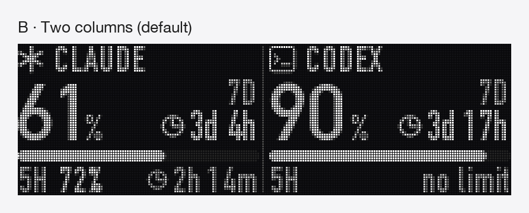
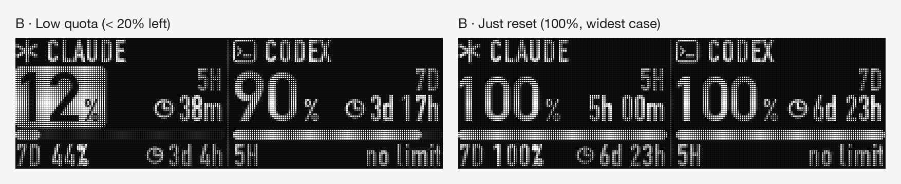
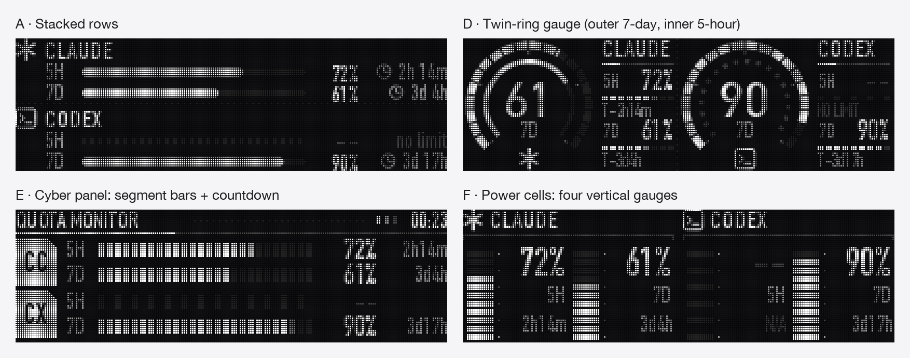

# rog-omni-oled

**English** | [简体中文](README.zh-CN.md) | [日本語](README.ja.md)

Drive the OLED screen of ROG keyboards connected through the ROG Omni receiver from macOS: show text and images, or turn it into a **live quota dashboard for Claude Code and Codex**.



## Features

- **Native quality**: 208×64 pixels, 16 gray levels, anti-aliased text and dithered images.
- **Quota dashboard**: Claude on the left, Codex on the right. The big number is whichever window (5-hour or 7-day) has the least quota left, next to its reset countdown. Below 20% the number turns inverted as a warning.
- **Runs in the background**: starts at login via launchd. Sends a frame only when the picture changes, never writes the keyboard's flash on refresh, and pauses polling and sending while you are away or the keyboard sleeps.
- **Command-line tool**: push a line of text or an image at any time, or switch back to a built-in ROG animation.

## Compatibility

| | |
|---|---|
| OS | macOS (tested on Apple Silicon); the dashboard uses fonts that ship with macOS |
| Runtime | Python 3.9+; Node 18+ (only for the Claude quota) |
| Connection | Wireless through the ROG Omni receiver (USB `0B05:1ACE`) only; wired and Bluetooth are not implemented |
| Tested hardware | One ROG keyboard paired with an Omni receiver (the receiver reports keyboard PID `0x1C23`). The original protocol author tested the ROG Azoth. Other ROG keyboards with an OLED screen may work but are untested |

## Install

```bash
git clone https://github.com/ldk-tokyo/rog-omni-oled.git
cd rog-omni-oled
python3 -m venv .venv
.venv/bin/pip install -r requirements.txt
```

## Command line

```bash
.venv/bin/python rog_oled.py status                       # connection state and battery
.venv/bin/python rog_oled.py text "Hello"                  # one line of text (size picked automatically)
.venv/bin/python rog_oled.py text "GG" --size 40           # fixed font size
.venv/bin/python rog_oled.py text "Hi" --preview p.png --dry-run   # preview only, don't send
.venv/bin/python rog_oled.py image logo.png                # image (scaled, dithered to 16 gray levels)
.venv/bin/python rog_oled.py animation 0                   # back to a built-in animation (0–5)
```

If the keyboard is asleep, the tool asks you to press a key and sends once it wakes up. Content sent from the command line is saved on the keyboard and survives unplugging.

## Quota dashboard

```bash
./install.sh      # install as a login service and start it (log: ~/Library/Logs/rog-oled.log)
./uninstall.sh    # stop and remove it
.venv/bin/python quota_daemon.py --once   # refresh once, for troubleshooting
```

`install.sh` installs missing dependencies (the Python virtual environment and the Node packages in `usage/`) and prints the login command if Claude is not signed in yet.

### Data sources

| | How | Every | Requires |
|---|---|---|---|
| **Codex** | A long-running `codex app-server`, calling `account/rateLimits/read` | 2 min | [Codex CLI](https://github.com/openai/codex) installed and signed in |
| **Claude** | Runs [`usage/claude_usage.mjs`](usage/claude_usage.mjs), which reads plan usage through the [Claude Agent SDK](https://code.claude.com/docs/en/agent-sdk/overview) | 5 min | Node 18+; sign in once with the official `claude` binary bundled with the SDK (below) |

```bash
usage/node_modules/@anthropic-ai/claude-agent-sdk-darwin-arm64/claude auth login --claudeai
```

If either side has no data, its column shows `no data` and the other column is unaffected. Once a reset time passes, that window shows 100% right away without waiting for the next poll.



### Tuning

- Refresh and polling intervals, idle detection: `TICK_S`, `CODEX_EVERY_S`, `CLAUDE_EVERY_S`, `IDLE_LIMIT_S` at the top of [`quota_daemon.py`](quota_daemon.py).
- Warning threshold: `LOW` in [`dashboard.py`](dashboard.py) (20% by default).
- Other layouts: `dashboard.py` also has A (stacked rows), D (twin-ring gauge), E (cyber panel) and F (power cells). `.venv/bin/python dashboard.py push D` sends a sample to the keyboard; `.venv/bin/python dashboard.py mockups` regenerates the sample images in `docs/` (English, Chinese and Japanese labels).



## Read this before using the Claude quota

- **Only your own official sign-in**: this project never reads or stores credentials. The query is made by Anthropic's official Claude Code binary (installed with the Agent SDK), using the account you signed in with via `claude auth login`. It sends no prompt, calls no model, writes no session transcript, and does not load your Claude Code settings or plugins.
- **Experimental API**: the query uses `usage_EXPERIMENTAL_MAY_CHANGE_DO_NOT_RELY_ON_THIS_API_YET`, which the SDK marks as experimental and may rename or remove. That is why the SDK is pinned to `0.3.302`. If the Claude column stops updating after an upgrade, check the log first.
- **Usage policy**: Anthropic's [Agent SDK documentation](https://code.claude.com/docs/en/agent-sdk/overview) states that, unless previously approved, third-party developers may not offer claude.ai login or rate limits in their products. This project is meant as a personal tool: each user signs in with their own account to see their own usage. If you build something for other people on top of it, do not reuse this sign-in method, and make sure you comply with Anthropic's terms.
- **Optional**: you don't have to sign in to Claude. The Claude column then shows `no data`, and the keyboard driver and the Codex side keep working.

## Protocol notes

For anyone porting this to another platform. The protocol is reverse-engineered and unofficial.

- **Device**: Omni receiver `VID 0x0B05 / PID 0x1ACE`, vendor-defined interface on usage page `0xFF00`, 64-byte output reports with report ID `0x02`.
- **Queries**: `02 12 03` replies with byte 5 = `1` when the keyboard is online; `02 12 01` replies with the battery percentage in byte 6.
- **Banner upload**:
  1. Header `02 62 00 00 00 <style> 01 D0 00 <height> 00 <packet count low> <packet count high>` (style `0xFF` = plain black background, height 64; the other built-in backgrounds use height 46)
  2. Data packets `02 62 01 <index low> <index high>` + 59 bytes of pixels, with the index counting down from packet count − 1 to 0
  3. End packet `02 62 02`
  4. Optional save packet `02 50 55`, which writes to the keyboard's storage. **The banner shows immediately without it** (verified), so frequent refreshes can skip it.
- **Pixel format** (verified on hardware): 208 pixels wide, rows top to bottom; 4-bit grayscale (0–15) per pixel, two pixels per byte, **low nibble = left pixel**.
- **Timing**: through the wireless relay, packets need about 15 ms between them; a full frame takes about 2 seconds.
- **Built-in animations**: `02 61 00 00 00 <0–5>`, followed by the save packet.

## Files

| File | Purpose |
|---|---|
| [`rog_oled.py`](rog_oled.py) | Device communication, pixel packing, command-line tool |
| [`dashboard.py`](dashboard.py) | Dashboard layouts and rendering (anti-aliased, supersampled) |
| [`quota_daemon.py`](quota_daemon.py) | Background service: fetch, render, send when changed |
| [`usage/claude_usage.mjs`](usage/claude_usage.mjs) | Claude plan usage through the Agent SDK |
| [`install.sh`](install.sh) / [`uninstall.sh`](uninstall.sh) | Install / remove the launchd service |

## Acknowledgements

The OLED banner protocol comes from [Delido/signalrgb-plugins](https://github.com/Delido/signalrgb-plugins) (Apache-2.0). This project verified on hardware the 208×64, 4-bit grayscale pixel format and that the banner refreshes without the save command.

## Disclaimer

This is an unofficial personal project, not affiliated with or endorsed by ASUSTeK, Anthropic or OpenAI. ROG is a trademark of ASUSTeK Computer Inc. The tool writes data to your keyboard; use it at your own risk.

## License

[Apache License 2.0](LICENSE); see also [NOTICE](NOTICE).
