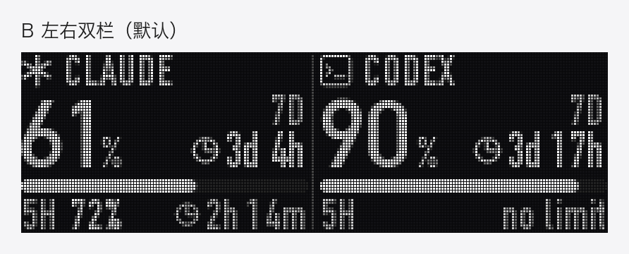
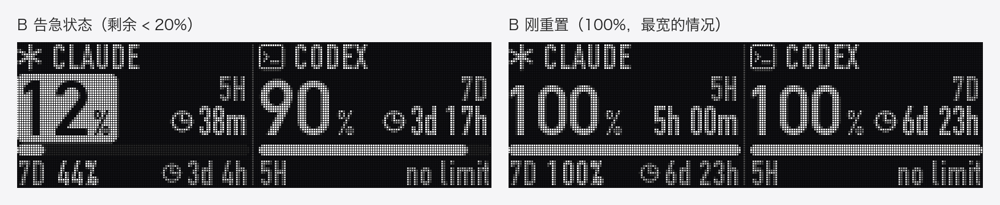
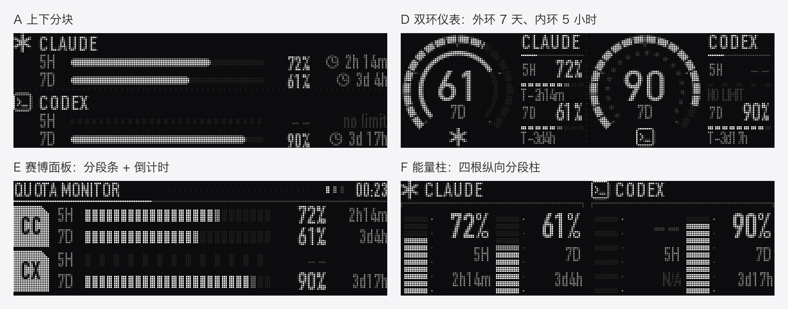

# rog-omni-oled

[English](README.md) | **简体中文** | [日本語](README.ja.md)

在 macOS 上驱动 ROG 键盘的 OLED 屏（经 ROG Omni 无线接收器）：显示文字、图片，或者把它变成 **Claude Code / Codex 剩余额度的实时看板**。



## 功能

- **原生画质**：208×64 像素、16 级灰度，支持抗锯齿文字和图片抖动。
- **额度看板**：左右两栏分别显示 Claude 和 Codex。大数字是最紧张的那个窗口（5 小时或 7 天）还剩多少，旁边是重置倒计时；剩余低于 20% 时大数字反白告警。
- **后台常驻**：用 launchd 开机自启。画面变化才发送，刷新不写键盘闪存；键鼠空闲或键盘休眠时暂停查询和发送。
- **命令行工具**：随时往屏幕发一行字、一张图，或切回 ROG 内置动画。

## 兼容性

| | |
|---|---|
| 系统 | macOS（在 Apple Silicon 上测试）；看板用到 macOS 自带字体 |
| 运行环境 | Python 3.9+；Node 18+（只有 Claude 额度查询需要） |
| 连接方式 | 只支持经 ROG Omni 接收器（USB `0B05:1ACE`）的无线连接，未实现有线和蓝牙 |
| 已验证硬件 | 一把经 Omni 接收器连接的 ROG 键盘（接收器报告的键盘 PID 为 `0x1C23`）；协议原作者在 ROG Azoth 上测试过。其他带 OLED 屏的 ROG 键盘可能也能用，但没有验证 |

## 安装

```bash
git clone https://github.com/ldk-tokyo/rog-omni-oled.git
cd rog-omni-oled
python3 -m venv .venv
.venv/bin/pip install -r requirements.txt
```

## 命令行用法

```bash
.venv/bin/python rog_oled.py status                       # 连接状态、电量
.venv/bin/python rog_oled.py text "Hello 你好"             # 显示一行文字（自动选字号）
.venv/bin/python rog_oled.py text "GG" --size 40           # 指定字号
.venv/bin/python rog_oled.py text "Hi" --preview p.png --dry-run   # 只生成预览图，不发送
.venv/bin/python rog_oled.py image logo.png                # 显示图片（自动缩放，抖动到 16 级灰度）
.venv/bin/python rog_oled.py animation 0                   # 切回内置动画（0–5）
```

键盘休眠时，工具会提示你按一下键盘，等它醒来再发送。命令行发送的内容会保存在键盘里，重新插拔后依然保留。

## 额度看板

```bash
./install.sh      # 安装为开机自启服务并立即启动（日志：~/Library/Logs/rog-oled.log）
./uninstall.sh    # 停止并移除
.venv/bin/python quota_daemon.py --once   # 手动刷新一次，用于排查
```

`install.sh` 会在缺少依赖时自动安装（Python 虚拟环境、`usage/` 下的 Node 依赖），并在 Claude 还没登录时提示登录命令。

### 数据来源

| | 方式 | 频率 | 前提 |
|---|---|---|---|
| **Codex** | 常驻 `codex app-server`，调用 `account/rateLimits/read` | 每 2 分钟 | 已安装并登录 [Codex CLI](https://github.com/openai/codex) |
| **Claude** | 运行 [`usage/claude_usage.mjs`](usage/claude_usage.mjs)，通过 [Claude Agent SDK](https://code.claude.com/docs/en/agent-sdk/overview) 查询订阅用量 | 每 5 分钟 | Node 18+；用 SDK 自带的官方 `claude` 程序登录一次（见下） |

```bash
usage/node_modules/@anthropic-ai/claude-agent-sdk-darwin-arm64/claude auth login --claudeai
```

两边任何一方没有数据时，对应那栏显示 `no data`，不影响另一栏。重置时间一过，那个窗口直接显示 100%，不用等下一次查询。



### 调整

- 刷新与查询间隔、空闲判定：[`quota_daemon.py`](quota_daemon.py) 顶部的 `TICK_S`、`CODEX_EVERY_S`、`CLAUDE_EVERY_S`、`IDLE_LIMIT_S`。
- 告急阈值：[`dashboard.py`](dashboard.py) 里的 `LOW`（默认 20%）。
- 其他布局：`dashboard.py` 里还有 A（上下分块）、D（双环仪表）、E（赛博面板）、F（能量柱）。`.venv/bin/python dashboard.py push D` 把示例发到键盘上看效果；`.venv/bin/python dashboard.py mockups` 重新生成 `docs/` 下的示例图（英 / 中 / 日三种标注）。



## 关于 Claude 额度查询，请先读这里

- **只用你自己的官方登录**：本项目不读取、不保存任何凭据。查询由 Anthropic 官方的 Claude Code 程序完成（随 Agent SDK 一起安装），用的是你自己用 `claude auth login` 登录的账号。查询时不发送提示词、不调用模型、不写会话记录，也不加载你的 Claude Code 设置和插件。
- **实验性接口**：查询用的是 SDK 里标为实验性的 `usage_EXPERIMENTAL_MAY_CHANGE_DO_NOT_RELY_ON_THIS_API_YET`，以后可能改名或移除。所以 SDK 版本固定在 `0.3.302`；升级后如果 Claude 那栏一直不更新，先看日志。
- **使用政策**：Anthropic 的 [Agent SDK 文档](https://code.claude.com/docs/en/agent-sdk/overview)规定，未经批准，第三方开发者不得在自己的产品里提供 claude.ai 登录或订阅额度。本项目的定位是个人工具：每位使用者用自己的账号查看自己的用量。如果你要在此基础上做面向他人的产品，请不要沿用这种登录方式，并自行确认符合 Anthropic 的条款。
- **可以不用**：不登录 Claude 也没关系，Claude 那栏显示 `no data`，键盘驱动和 Codex 部分照常工作。

## 协议说明

给想在其他平台实现的人参考。协议是逆向得到的，非官方。

- **设备**：Omni 接收器 `VID 0x0B05 / PID 0x1ACE`，厂商自定义接口 usage page `0xFF00`，64 字节输出报告，报告 ID `0x02`。
- **查询**：`02 12 03` 返回第 5 字节为 `1` 表示键盘在线；`02 12 01` 返回第 6 字节为电量百分比。
- **上传横幅**：
  1. 头包 `02 62 00 00 00 <样式> 01 D0 00 <高度> 00 <包数低字节> <包数高字节>`（样式 `0xFF` = 纯黑背景，高度 64；其他内置背景高度 46）
  2. 数据包 `02 62 01 <序号低> <序号高>` + 59 字节像素，序号从"包数 − 1"倒数到 0
  3. 结束包 `02 62 02`
  4. 可选的保存包 `02 50 55`：写入键盘存储。**不发也能立即显示**（已实测），所以频繁刷新时可以省掉。
- **像素格式**（实测确认）：宽 208 像素，逐行从上到下；每像素 4 位灰度（0–15），每字节 2 个像素，**低半字节是左边的像素**。
- **时序**：经无线中转时，每个数据包之间需要约 15 ms，整屏约 2 秒。
- **内置动画**：`02 61 00 00 00 <0–5>`，然后发保存包。

## 文件

| 文件 | 作用 |
|---|---|
| [`rog_oled.py`](rog_oled.py) | 设备通信、像素打包、命令行工具 |
| [`dashboard.py`](dashboard.py) | 看板布局与渲染（抗锯齿、超采样） |
| [`quota_daemon.py`](quota_daemon.py) | 后台常驻：取数、渲染、按需发送 |
| [`usage/claude_usage.mjs`](usage/claude_usage.mjs) | 通过 Agent SDK 查询 Claude 订阅用量 |
| [`install.sh`](install.sh) / [`uninstall.sh`](uninstall.sh) | 安装 / 移除 launchd 服务 |

## 致谢

OLED 横幅协议来自 [Delido/signalrgb-plugins](https://github.com/Delido/signalrgb-plugins)（Apache-2.0）。本项目在此基础上实测确认了 208×64、4 位灰度的像素格式，以及不保存也能刷新的行为。

## 免责声明

本项目是非官方的个人项目，与 ASUSTeK、Anthropic、OpenAI 均无关联，也未获它们认可。ROG 是 ASUSTeK Computer Inc. 的商标。工具会向键盘写入数据，使用风险自负。

## 许可证

[Apache License 2.0](LICENSE)，另见 [NOTICE](NOTICE)。
